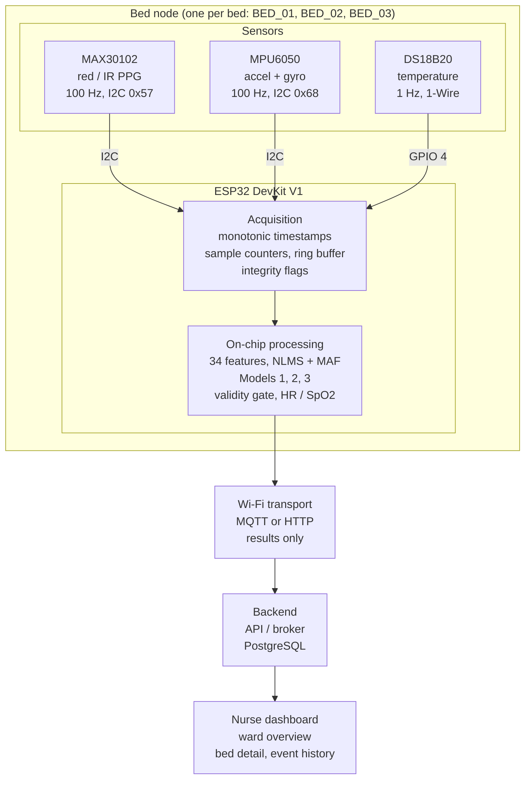
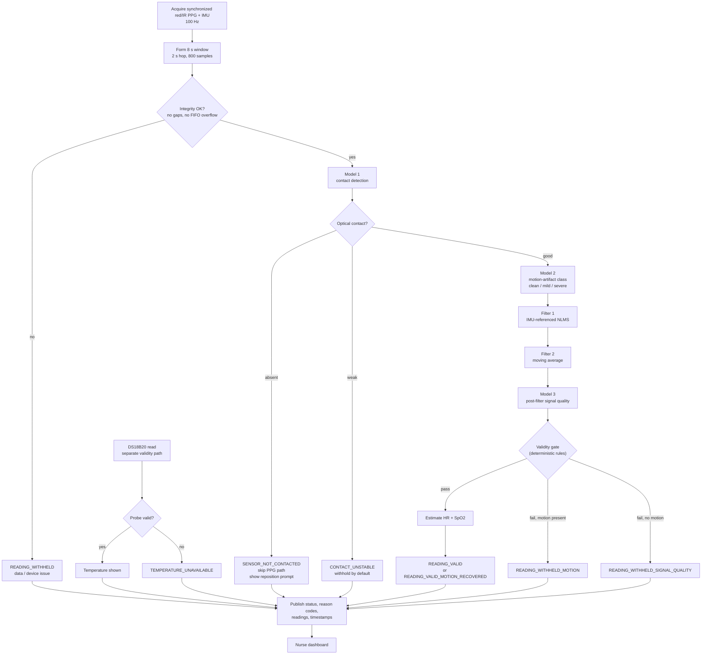
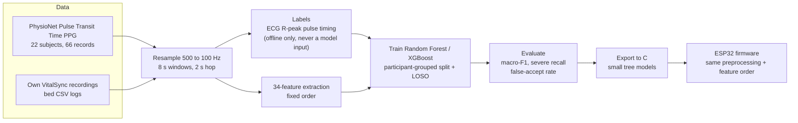

# VitalSync - System Architecture

VitalSync is a multi-bed monitoring prototype that tells a nurse whether each reading is trustworthy: whether contact is good, whether motion is corrupting the signal, and whether the processed PPG is usable. It is an engineering prototype for decision support, not a clinically validated diagnostic or alarm system.

Inference runs **on the ESP32**. The network carries results (status, reason codes, readings, timestamps), and the backend and dashboard store and display them.

## 1. System block diagram

## 2. Per-window processing flowchart (runs on the ESP32)

An 8 s window (800 samples at 100 Hz) is produced every 2 s.

Model 1 and Model 3 are not duplicates. Model 1 asks whether the finger is optically coupled to the sensor. Model 3 asks whether the processed waveform is usable. The filters improve a waveform but do not prove it is accurate, so Model 3 and the validity gate judge the result after filtering.

## 3. Offline ML pipeline (how the models get onto the chip)

Rules that keep training and deployment consistent:
- ECG is used only to build labels offline. It is not available at deployment and is never a model input.
- The same preprocessing, feature calculations and feature order are applied in training and in firmware.
- Model 2 uses a zero-patient-calibration design, so a new patient needs no personal baseline recording.

## 4. Reading states shown on the dashboard

| Condition | State | Dashboard action |
|---|---|---|
| No fresh packet from node | `DEVICE_OFFLINE` | Show last communication time; not a patient condition |
| No contact | `SENSOR_NOT_CONTACTED` | Suppress HR/SpO2, show reposition instruction |
| Weak contact | `CONTACT_UNSTABLE` | Withhold until quality passes |
| Contact good, no artifact, SQI good | `READING_VALID` | Show fresh HR/SpO2 with timestamp |
| Motion artifact, filtering recovers, SQI passes | `READING_VALID_MOTION_RECOVERED` | Show values with motion/recovered badge |
| Motion artifact, SQI poor after filtering | `READING_WITHHELD_MOTION` | Withhold; ask for a steady hand |
| Contact good, no motion, SQI poor | `READING_WITHHELD_SIGNAL_QUALITY` | Withhold; explain the reason |
| Temperature probe invalid or stale | `TEMPERATURE_UNAVAILABLE` | Separate warning; PPG state unaffected |

A withheld reading never reuses an old value as current. The last reliable value is shown separately, with its exact timestamp.

## 5. Hardware summary

| Item | Choice |
|---|---|
| Controller | ESP32 DevKit V1 |
| Optical sensor | MAX30102, red/IR PPG, 100 Hz |
| Motion sensor | MPU6050, accel + gyro, 100 Hz, synchronized with PPG |
| Temperature | DS18B20, 1 Hz, probe/surface temperature (not core body temperature) |
| Window | 8 s, 2 s hop, 800 samples per channel |

## Safety boundary

VitalSync is a student engineering prototype. It is not intended to diagnose, treat, triage or independently alarm for medical emergencies, and it must not replace approved clinical monitoring or clinician judgment. SpO2 values are experimental estimates and are not clinically validated.
