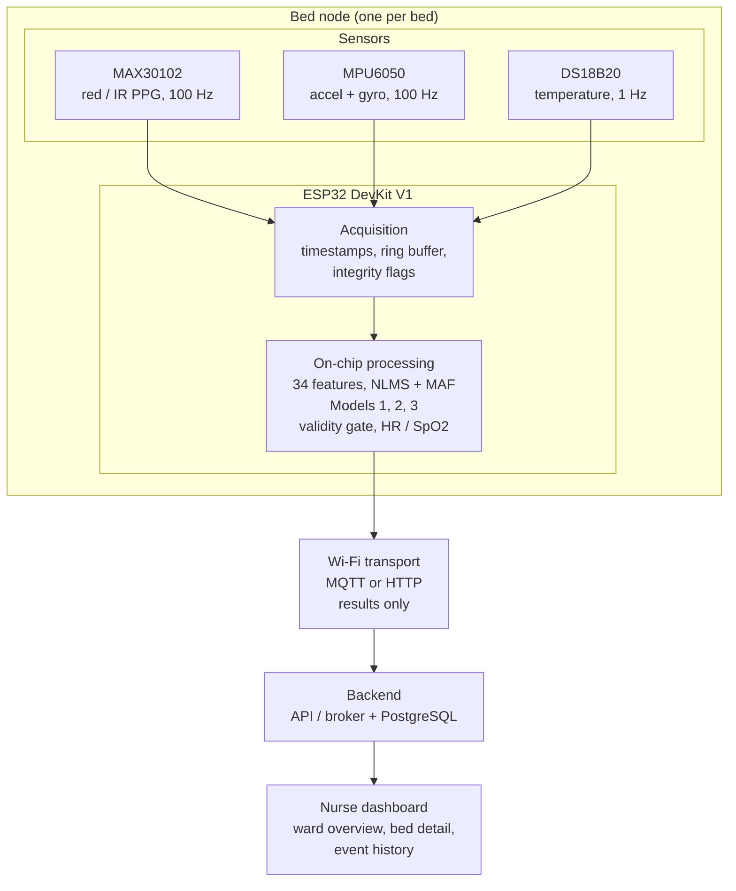
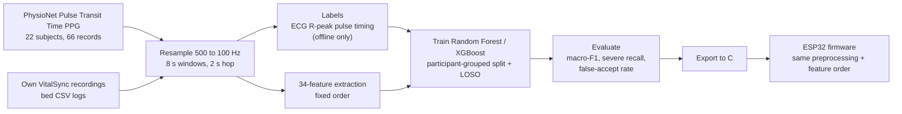

# VitalSync Copilot

**A multi-bed patient monitoring prototype that tells a nurse not just *what* the reading is, but *whether the reading can be trusted*.**

> **Safety notice:** VitalSync is a student engineering prototype for decision support. It is **not** a clinically validated diagnostic, triage, or alarm system, and it must not replace approved clinical monitoring or clinician judgment. SpO2 values are experimental estimates.

---

## Table of Contents

- [Why VitalSync](#why-vitalsync)
- [Key Features](#key-features)
- [How It Works](#how-it-works)
- [Reading States](#reading-states)
- [Hardware](#hardware)
- [Offline ML Pipeline](#offline-ml-pipeline)
- [Repository Structure](#repository-structure)
- [Getting Started](#getting-started)
- [Documentation](#documentation)
- [Limitations and Safety Boundary](#limitations-and-safety-boundary)
- [Author](#author)

---

## Why VitalSync

Pulse oximetry readings are easily corrupted by a loose finger, patient movement, or a poor-quality waveform. Most monitors still display a number, and a wrong number looks identical to a right one.

VitalSync adds a **trust layer** on top of heart rate and SpO2. For every bed, every few seconds, it answers three questions before showing a value:

1. **Is the sensor actually touching the patient?**
2. **Is motion corrupting the signal, and can it be filtered out?**
3. **Is the processed PPG waveform good enough to estimate from?**

If the answer to any of these is "no", the reading is **withheld with a reason** (for example, "ask for a steady hand" or "reposition the sensor") instead of showing a misleading number.

## Key Features

- **Multi-bed monitoring:** one sensor node per bed (`BED_01`, `BED_02`, `BED_03`) feeding a single nurse dashboard.
- **On-device inference:** all machine learning runs on the ESP32. The network carries only results (status, reason codes, readings, timestamps), not raw waveforms.
- **Three-model quality pipeline:** contact detection, motion-artifact classification, and post-filter signal quality.
- **Motion cancellation:** IMU-referenced NLMS adaptive filter followed by a moving-average filter.
- **Deterministic validity gate:** rule-based final check so a reading is shown only when it has earned it.
- **Honest display:** a withheld reading never reuses an old value as current; the last reliable value is shown separately with its exact timestamp.
- **Zero patient calibration:** a new patient needs no personal baseline recording.
- **Independent temperature path:** DS18B20 failures raise a separate warning and do not affect the PPG state.

## How It Works



### Per-window processing (runs on the ESP32)

An **8 s window (800 samples at 100 Hz)** is produced every **2 s**.

| Step | What happens |
| ---- | ------------ |
| 1. Integrity check | Rejects windows with gaps or FIFO overflow (`READING_WITHHELD`) |
| 2. **Model 1:** contact detection | Absent, weak, or good optical contact |
| 3. **Model 2:** motion-artifact class | Clean, mild, or severe |
| 4. Filter 1 | IMU-referenced NLMS adaptive filter |
| 5. Filter 2 | Moving-average filter |
| 6. **Model 3:** post-filter signal quality | Is the *processed* waveform usable? |
| 7. Validity gate | Deterministic rules decide pass or fail |
| 8. Estimation | HR and SpO2 computed only if the gate passes |
| 9. Publish | Status, reason codes, readings, and timestamps sent to the dashboard |

> Model 1 and Model 3 are not duplicates. Model 1 asks whether the finger is optically coupled to the sensor. Model 3 asks whether the waveform is usable after filtering. Filters improve a waveform but do not prove it is accurate, so quality is judged *after* filtering.

## Reading States

| Condition | State | Dashboard action |
| --- | --- | --- |
| No fresh packet from node | `DEVICE_OFFLINE` | Show last communication time; not a patient condition |
| No contact | `SENSOR_NOT_CONTACTED` | Suppress HR/SpO2, show reposition instruction |
| Weak contact | `CONTACT_UNSTABLE` | Withhold until quality passes |
| Contact good, no artifact, SQI good | `READING_VALID` | Show fresh HR/SpO2 with timestamp |
| Motion artifact, filtering recovers, SQI passes | `READING_VALID_MOTION_RECOVERED` | Show values with motion/recovered badge |
| Motion artifact, SQI poor after filtering | `READING_WITHHELD_MOTION` | Withhold; ask for a steady hand |
| Contact good, no motion, SQI poor | `READING_WITHHELD_SIGNAL_QUALITY` | Withhold; explain the reason |
| Temperature probe invalid or stale | `TEMPERATURE_UNAVAILABLE` | Separate warning; PPG state unaffected |

## Hardware

| Item | Choice |
| --- | --- |
| Controller | ESP32 DevKit V1 |
| Optical sensor | MAX30102, red/IR PPG, 100 Hz, I2C address `0x57` |
| Motion sensor | MPU6050, accel + gyro, 100 Hz, I2C address `0x68`, synchronized with PPG |
| Temperature | DS18B20, 1 Hz, 1-Wire on GPIO 4 (probe/surface temperature, **not** core body temperature) |
| Window | 8 s, 2 s hop, 800 samples per channel |

Wiring and board files live in the [`hardware/`](hardware/) folder.

## Offline ML Pipeline

Models are trained offline and exported to small C tree models that run on the ESP32.



**Consistency rules between training and deployment**

- ECG is used **only to build labels offline**. It is never available at deployment and never a model input.
- The same preprocessing, feature calculations, and feature order are used in training and in firmware.
- Evaluation uses participant-grouped splits and leave-one-subject-out (LOSO) validation, and tracks macro-F1, severe-motion recall, and false-accept rate.

## Repository Structure

```
Vital-Sync-Copilot/
├── Software/          # Firmware, ML pipeline, backend and dashboard code
├── hardware/          # Hardware design and wiring files
├── ARCHITECTURE.md    # Detailed system architecture and diagrams
└── README.md          # You are here
```

## Getting Started

1. **Clone the repository**
   ```bash
   git clone https://github.com/KirtiSharma99/Vital-Sync-Copilot.git
   cd Vital-Sync-Copilot
   ```
2. **Hardware:** assemble one bed node (ESP32 DevKit V1 + MAX30102 + MPU6050 + DS18B20) using the files in [`hardware/`](hardware/).
3. **Firmware and software:** see the contents of [`Software/`](Software/) for the ESP32 firmware, model training, and backend/dashboard components.
4. **Connect:** configure Wi-Fi and the MQTT/HTTP endpoint on each node, then start the backend and open the nurse dashboard.

> Detailed build, flash, and run steps for each component should be documented in the corresponding subfolder under `Software/` and `hardware/`.

## Documentation

- [`ARCHITECTURE.md`](ARCHITECTURE.md): full block diagram, per-window flowchart, offline ML pipeline, reading states, and hardware summary.

## Limitations and Safety Boundary

- Student engineering prototype; **not clinically validated**.
- Not intended to diagnose, treat, triage, or independently alarm for medical emergencies.
- SpO2 values are experimental estimates.
- Temperature is probe/surface temperature, not core body temperature.
- Must not replace approved clinical monitoring or clinician judgment.

## Team

VitalSync Copilot was built as a hackathon project by a team of four.

| Name | GitHub |
| --- | --- |
| Kirti Sharma | [@KirtiSharma99](https://github.com/KirtiSharma99) |
| Drishya Kumar | [@drishya-workspace](https://github.com/drishya-workspace) |
| Krithika B.B | [@kryti-4416](https://github.com/kryti-4416) |
| Rahul Desai | [@rahuldesai7100](https://github.com/rahuldesai7100) |
